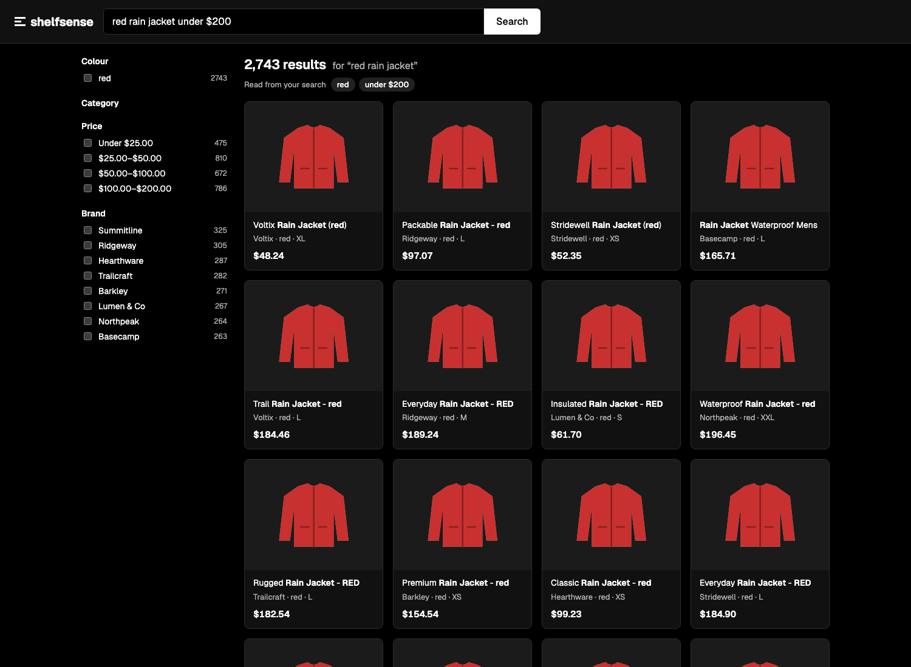
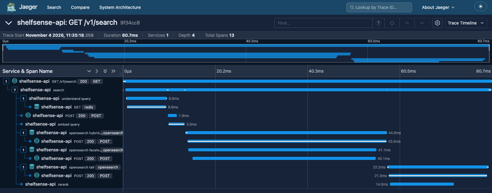
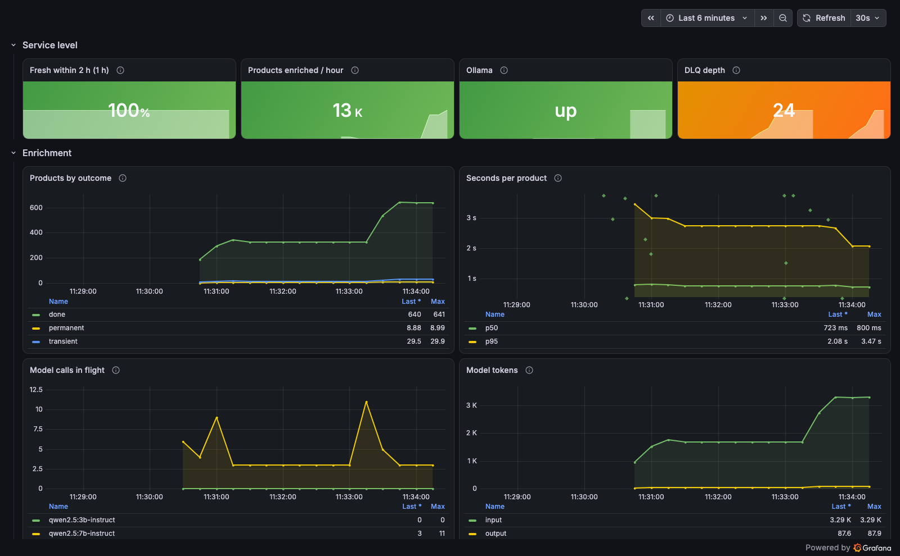
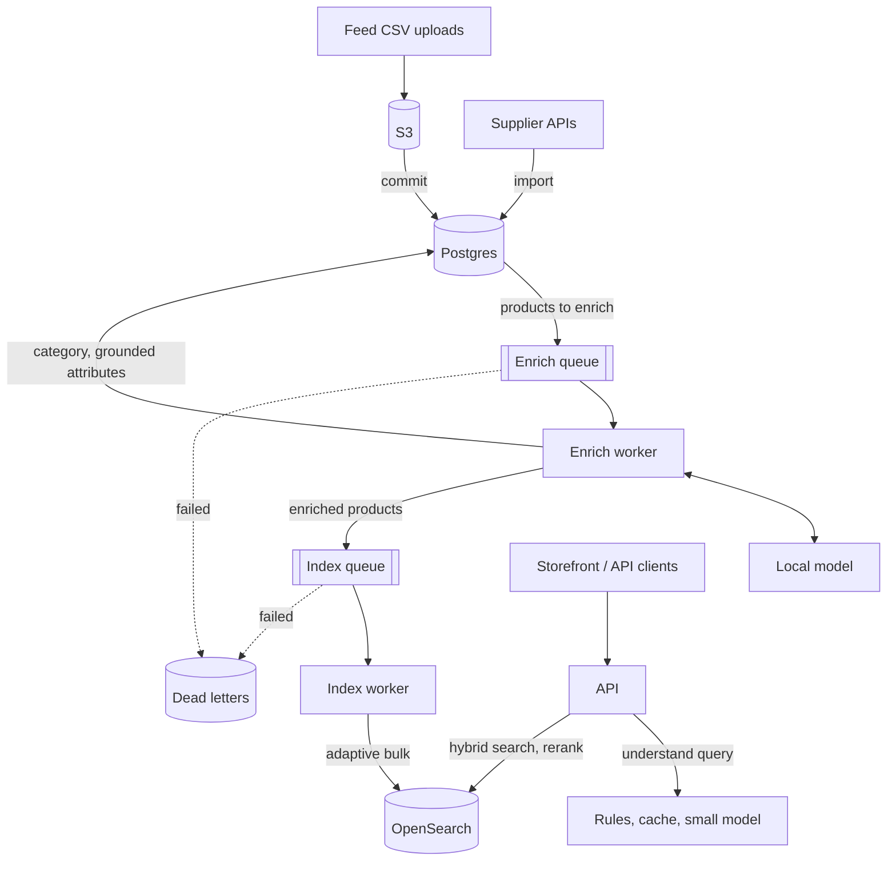
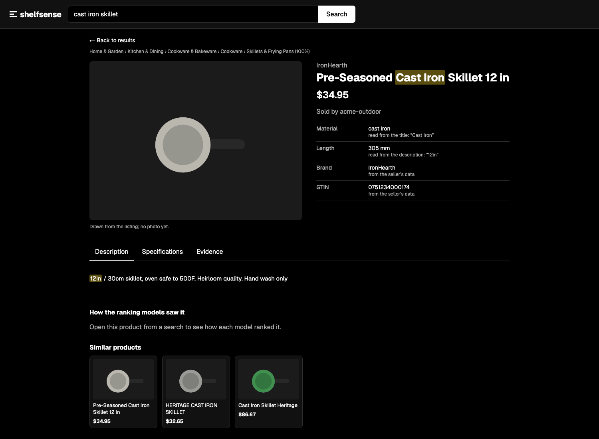

# Shelfsense

[](https://github.com/Abuubkar/shelfsense/actions/workflows/ci.yml)
[](https://github.com/Abuubkar/shelfsense/actions/workflows/release.yml)

**Marketplace catalog enrichment and search: messy supplier feeds in, classified products out, searchable in
plain language.**

Suppliers send product feeds in their own formats: CSV uploads or a paged API. Each product is classified into
the Google Product Taxonomy by a local model that can only answer from a shortlist. Its colour, material,
gender, size and length are extracted, and every value has to be backed by an exact quote from the listing. Then
it's indexed for hybrid search. Shoppers type things like *waterproof women's hiking boots under $150*; simple
queries are read by rules and the rest by a small local model under a time limit. Everything runs locally,
including the models.

> **Status: complete.** All 8 planned slices are built, tested and merged. Where it falls short of its own targets
> is listed under [Results](#results) and [Limitations](#limitations).



*"red rain jacket under $200": the colour and price were read from the query and applied as filters (the chips
under the result count), and the facets count the whole result set, not just the first page.*

## Highlights

- **The model can't make things up.** It picks a category from an enum of 15 candidates built per product, and its
  confidence comes from token log-probabilities, not a number it states. An extracted attribute is kept only if
  code finds its value quoted in the listing.
- **One bad product never fails its batch.** Queue workers decide per product: done moves on, transient is retried
  with backoff, and permanent is dead-lettered on its own with its reason recorded. A chaos run with 6% model
  failures, 429s from OpenSearch and a worker killed with SIGKILL lost nothing and did nothing twice.
- **Search pages through tens of thousands of results consistently.** Every page of a query reads the same
  point-in-time snapshot, so a product appears exactly once even while the index changes. A test pages 5,000
  products while editing the index between pages.
- **Changes ship without downtime.** Schema migrations go expand, backfill, contract; a search index version is
  rebuilt beside the live one and swapped with one atomic alias move. Both were rehearsed with a loop reading
  search throughout: 0 errors.
- **Measured, not eyeballed.** A golden set of 400 products and 120 queries scores classification, attribute
  extraction, query parsing and ranking. Model replies are recorded, so every pull request replays the evals
  without a GPU and fails on a regression.
- **Observable end to end.** One product's path from SQS through its model call to its bulk index is a chain of
  linked traces; shopper queries and listing text leave the process only as hashes.

## Results

Measured on an Apple M1 Pro laptop with 16 GB. Enrichment uses `qwen2.5:7b-instruct` and query parsing
`qwen2.5:3b-instruct`, both through Ollama, on the dev split of the golden set (280 products, 80 queries).

| | Result | Target | Where |
|---|---|---|---|
| Right leaf category | **0.836** | ≥ 0.80 | [eval report](evals/REPORT.md#enrichment-280-products) |
| Attribute extraction (macro F1) | **0.893** | ≥ 0.85 | [eval report](evals/REPORT.md#enrichment-280-products) |
| Attributes dropped for lack of evidence | **4.6%** | ≤ 5% | [eval report](evals/REPORT.md#enrichment-280-products) |
| Valid JSON on the first try | **99.6%** | ≥ 98% | [eval report](evals/REPORT.md#enrichment-280-products) |
| Products enriched per hour, one Ollama | **629** | ≥ 400 | [eval report](evals/REPORT.md#enrichment-280-products) |
| Query parses exactly right | **0.763** | ≥ 0.75 | [eval report](evals/REPORT.md#query-parsing-80-queries) |
| Search ranking (nDCG@10) | **0.824** | ≥ 0.72 | [eval report](evals/REPORT.md#search-80-queries-over-400-golden-products) |
| Ranking gain over keyword search alone | **+0.111** | ≥ +0.08 | [eval report](evals/REPORT.md#search-80-queries-over-400-golden-products) |
| Fast-path search p95, CI's perf smoke (500 searches, 5,000 products) | **33 ms** | ≤ 150 ms | [ADR 0021](docs/adr/0021-smaller-reranker.md) |
| Chaos: 2,000 products, injected model and OpenSearch failures, a worker killed | **0 lost, 0 duplicated** | 0 | [challenges](docs/challenges.md) |
| Live migrations on 299,545 products, search read throughout | **0 errors** in 1,296 requests | 0 | [migrations](docs/migrations.md) |

Where it falls short, reported as measured and never re-targeted:

| | Result | Target | Where |
|---|---|---|---|
| Right category path (hierarchical F1) | 0.886 | ≥ 0.90 | [eval report](evals/REPORT.md#enrichment-280-products) |
| Right category among the 15 shown to the model | 0.900 | ≥ 0.97 | [eval report](evals/REPORT.md#enrichment-280-products) |
| Filters read from queries (slot F1) | 0.657 | ≥ 0.90 | [eval report](evals/REPORT.md#query-parsing-80-queries) |
| Searches with no results | 3.8% | ≤ 2% | [eval report](evals/REPORT.md#search-80-queries-over-400-golden-products) |
| Cache-hit and model-path search p95, live on the full catalog | 1,876 ms / 3,630 ms | ≤ 180 ms / 3 s | [eval report](evals/REPORT.md#search-latency-1000-searches-on-the-catalog-live) |

The live latency figures predate the current reranker ([ADR 0021](docs/adr/0021-smaller-reranker.md)), which cut
reranking from ~2.5 s to ~10 ms; they'll be re-measured with `make eval-latency`. The held-out test split runs only
to report, never to tune ([REPORT-test.md](evals/REPORT-test.md)). Model choices were compared in a sweep:
[SWEEP.md](evals/SWEEP.md).

## Seeing inside it

One search in Jaeger: the parse came from the Redis cache, the head's hybrid retrieval and the facet counts ran
side by side, and the rest of the page was fetched while the top 5 were reranked.



One search that needed the query model, as a trace (`uv run python scripts/trace_tree.py --search --path llm`). The
model call is most of it; facets run alongside the head retrieval, and only the top 5 are reranked:

```text
GET /v1/search  [shelfsense-api]  2,871.6 ms  (route=/v1/search)
  search  [shelfsense-api]  2,868.5 ms  (parse_source=llm, total=14426)
    understand query  [shelfsense-api]  1,402.5 ms  (parse_source=llm)
      chat qwen2.5:3b-instruct  [shelfsense-api]  1,401.2 ms  (prompt_version=query/1, model=qwen2.5:3b-instruct, in=674, out=69, tokens_per_second=53.6)
    embed query  [shelfsense-api]  211.2 ms
    opensearch hybrid  [shelfsense-api]  1,136.7 ms  (op=search)
    opensearch facets  [shelfsense-api]  1,118.2 ms  (op=search)
    opensearch tail  [shelfsense-api]  92.3 ms  (op=search)
    rerank  [shelfsense-api]  70.2 ms  (rerank_docs=5)
```

One product's path during a chaos run (`--product <id>`): its enrich message is a trace of its own, linked to the
feed commit that sent it, and the index request it sends starts another, linked back:

```text
process chaos-enrich-…  [shelfsense-worker-enrich]  2,608.4 ms  (receive_count=1)
  -> linked to span 9c8a3a8f1b850b4f in trace e9704cf9…   (the feed commit)
  enrich product  [shelfsense-worker-enrich]  206.5 ms  (product_id=01a1a50e-f8e3-…, outcome=done)
    chat qwen2.5:7b-instruct  47.8 ms  (prompt_version=enrich/2, in=300, out=8)
  send chaos-index-…  38.7 ms
  (+ 49 other products in this message, 2 failed)

process chaos-index-…  [shelfsense-worker-index]  510.6 ms
  -> linked to span dc4e8086ef921a07 in trace e4f1605c…   (the send above)
  opensearch bulk  34.9 ms  (batch_size=48)
```

The pipeline dashboard during two chaos runs (2,000 products each, with injected model failures and OpenSearch
429s): products by outcome, seconds per product with exemplars that open the slowest products' traces, model calls
in flight and tokens. The 24 dead letters are exactly the products whose replies stayed invalid after a retry.



A second dashboard, **Shelfsense / Search**, shows latency by parse path, the parse source mix, zero results and
per-route errors. The objectives and their burn-rate alerts are in [docs/slo.md](docs/slo.md).

## Quick start

You need Docker, [uv](https://docs.astral.sh/uv/) and [Ollama](https://ollama.com). The models run on the host,
because Docker on macOS has no GPU access.

```bash
git clone https://github.com/Abuubkar/shelfsense && cd shelfsense
docker compose up -d --wait                    # Postgres, OpenSearch, Floci (local SQS and S3), Redis
uv run alembic upgrade head
uv run python scripts/init_aws.py              # the feeds bucket and the queues, with dead-letter queues
uv run python scripts/load_taxonomy.py         # embeds 5,595 taxonomy paths (~1 min on CPU)
ollama pull qwen2.5:7b-instruct && ollama pull qwen2.5:3b-instruct   # enrichment and query models
uv run python scripts/seed.py --profile small  # 5,000 products from 50 seeded suppliers
uv run python scripts/sync_index.py            # index them
uv run uvicorn shelfsense_api.main:app --port 8020
```

Then search, and run the workers to enrich what feeds bring in:

```bash
curl 'localhost:8020/v1/search?q=waterproof%20hiking%20boots&page_size=5'
uv run python -m shelfsense_worker_enrich       # in its own terminal; likewise the next
uv run python -m shelfsense_worker_index
uv run python scripts/upload_feed.py data/feeds/sample.csv acme-outdoor   # upload, commit, queue
```

| Open | What you'll see |
|---|---|
| http://localhost:3020 | The storefront: search, facets, a product page with its evidence (`make web`) |
| http://localhost:8020/docs | The REST API |
| http://localhost:3022 | Grafana, with `docker compose --profile observability up -d` |
| http://localhost:16687 | Jaeger: a product's path through the queues, or a search step by step |

Merges to main publish signed images (`ghcr.io/abuubkar/shelfsense-{api,worker-enrich,worker-index,supplier-mock,web}`).
To check one before running it:

```bash
cosign verify ghcr.io/abuubkar/shelfsense-api:main \
  --certificate-identity-regexp '^https://github.com/Abuubkar/shelfsense/\.github/workflows/release\.yml@refs/heads/main$' \
  --certificate-oidc-issuer https://token.actions.githubusercontent.com
```

## How it works



1. **Ingest.** A feed is uploaded straight to object storage with a presigned URL, then committed: rows are
   validated (rejections keep their spreadsheet row numbers), and products are upserted only when their content
   hash changed. Committing the same feed twice changes nothing. Supplier APIs are imported page by page with
   overlap and reconciliation, resumable after a crash.
2. **Classify.** The listing's embedding shortlists 15 leaf categories; the model must pick one of them (or NONE)
   through a JSON-schema enum built for that product. Confidence is the probability of the tokens it chose.
3. **Extract.** In the same call the model proposes attributes, each with a quote. Code finds the quote in the
   listing and normalizes the value from it; a value whose quote isn't there is dropped and counted.
4. **Queue.** Enrichment and indexing are SQS workers with heartbeats, backpressure and per-product outcomes.
   Workers are idempotent: a product is skipped when it's already enriched for its current content, prompt and
   taxonomy release.
5. **Index.** Products are bulk-indexed with an AIMD batch size that halves when OpenSearch pushes back and grows
   when it doesn't. OpenSearch is derived data, rebuilt from Postgres when needed.
6. **Search.** A query is read by rules when it can be (no model call), else from a cache, else by the small model
   under a 2.5 s limit, and degrades to keywords on any failure. The result set is keyword or semantic matches
   after filters; the top 5 by hybrid score are reranked by a cross-encoder, and the rest page in score order on
   the same snapshot.



*Every attribute says where it came from. "Cast Iron" was quoted from the title and "12in" from the description;
code checked both quotes are in the listing and converted 12 in to 305 mm. Brand and GTIN came from the
supplier's own columns.*

### The API

REST on `:8020`, written first as [contracts/openapi.yaml](contracts/openapi.yaml). A search with a facet filter
(the response trimmed to one result and fewer fields):

```bash
curl 'localhost:8020/v1/search?q=rain%20jacket&color=red&page_size=2'
```

```json
{
  "items": [
    {
      "id": "01a19c80-a878-753c-aecf-9507966478db",
      "rank": 2,
      "title": "PREMIUM RAIN JACKET",
      "brand": "Stridewell",
      "price": {"amount_minor": 23787, "currency": "USD"},
      "color": "red",
      "size": "L"
    }
  ],
  "total": 2091,
  "facets": [{"name": "color", "values": [{"value": "red", "label": "red", "count": 2091}]}],
  "next_cursor": "eyJwIjp7InBpdCI6InM4MjhRUUVMY0hKdlpIVmpk...",
  "query_parse": {"source": "rules", "keywords": "rain jacket", "filters": {"colors": [], "price_max": null}}
}
```

Money is integer minor units with an ISO currency, never a float. Cursors are signed and bound to their query.
Feeds go through `POST /v1/feeds` (a presigned upload URL) and `POST /v1/feeds/{id}:commit`, and dead letters
through `POST /v1/admin/dlq/{queue}/redrive`. The same search is on GraphQL at `/graphql` (Relay connections), and
the [generated Python client](packages/clients/python) is used by the smoke test. Errors are RFC 9457
problem+json with a stable `code`, each documented in [docs/problems.md](docs/problems.md).

## Design decisions

| Decision | Why | ADR |
|---|---|---|
| Classify from a shortlist, with an enum-constrained answer | The model can't name a category that doesn't exist, and confidence comes from logprobs | [0002](docs/adr/0002-taxonomy-classification.md) |
| Money as integer minor units | No floats, no rounding, anywhere | [0003](docs/adr/0003-money-as-integer-minor-units.md) |
| One defined result set, a reranked head, a snapshot-paged tail | Deep pages stay consistent while the index changes | [0006](docs/adr/0006-hybrid-search-and-deep-pagination.md) |
| The OpenAPI file is the contract | Written first; CI fails if code would break a generated client | [0007](docs/adr/0007-spec-first-contracts-and-graphql.md) |
| Per-product outcomes and explicit dead letters | One bad product never fails a message of 50 | [0009](docs/adr/0009-queued-workers-and-per-item-failures.md) |
| Supplier imports reconcile by the supplier's own timestamps | Pages that shift mid-import don't lose or duplicate products | [0011](docs/adr/0011-supplier-api-import.md) |
| Typed facet columns, migrated expand and contract | Filters on real columns, changed while search kept serving | [0012](docs/adr/0012-typed-attribute-columns.md) |
| Taxonomy releases side by side | An upgrade reclassifies only what split or moved | [0013](docs/adr/0013-taxonomy-upgrades.md) |
| Rules first, a small model under a time limit | Most queries never wait on a model; a slow one degrades instead of failing | [0014](docs/adr/0014-query-understanding.md) |
| Every attribute grounded in an exact quote | A value the listing doesn't state is dropped, not trusted | [0015](docs/adr/0015-grounded-attribute-extraction.md) |
| Model replies recorded for replay | Evals run in CI without a GPU and give the live run's numbers | [0018](docs/adr/0018-evals.md) |
| Index versions swapped by an atomic alias move | A mapping change ships with no failed search | [0019](docs/adr/0019-index-versions-and-reindex.md) |
| Signed multi-arch images | Scanned before they're signed; only signed images verify | [0020](docs/adr/0020-ci-cd.md) |
| A small int8 cross-encoder over the top 5 | ~250× less rerank time than before, and better ranking on the golden set | [0021](docs/adr/0021-smaller-reranker.md) |
| OpenTelemetry with text hashed | A product is traceable end to end; seller and shopper text never leaves the process | [0022](docs/adr/0022-telemetry.md) |

## Development

```bash
make test          # unit tests, offline
make test-int      # against real Postgres, OpenSearch and Floci (needs Docker)
make eval          # the evals on the dev split, model replies replayed (no Ollama)
make eval LIVE=1   # the same against Ollama, re-recording
make chaos         # 2,000 products through failing stubs, a worker killed (~3 minutes)
make lint          # what CI's lint job runs
make web           # the storefront on :3020
make codegen       # after changing contracts/openapi.yaml or GraphQL types
```

Every command is in [CLAUDE.md](CLAUDE.md#run-it).

## Roadmap

Built in thin slices, each one end to end. The plan is in [03-shelfsense.md](03-shelfsense.md).

| Slice | Delivers | Status |
|---|---|---|
| 1 | Walking skeleton: a messy supplier CSV imported, bad rows rejected, products classified by a local model | Done |
| 2 | Faceted hybrid search, deep pagination, spec-first REST, typed client, GraphQL | Done |
| 3 | Queued enrichment and indexing with per-product failures, dead letters, chaos run | Done |
| 4 | A drifting supplier API, seeded catalogs, two live migrations | Done |
| 5a | Grounded attribute extraction and query understanding | Done |
| 5b | The storefront, chosen from prototypes | Done |
| 6 | Golden set and evals, model sweep, zero-downtime reindex | Done |
| 7 | CI on every pull request with a search performance smoke; signed images | Done |
| 8 | OpenTelemetry from feed row to search, SLOs, alerts and dashboards | Done |

## Limitations

- **Query parsing misses filters.** The 3B model leaves out most materials and misreads negations ("no leather");
  slot F1 is 0.66 against a 0.90 target. A larger model parses better but is too slow for the time limit.
- **Some products never see their right category.** The embedding shortlist misses it for 1 product in 10,
  mostly non-English listings, bundles and multi-use items.
- **Paged searches are capped per node.** Each first page holds a point-in-time snapshot for 5 minutes, and
  OpenSearch allows 300 per node: past ~300 paged searches in 5 minutes, searches fail.
- **One Ollama, shared.** Throughput is one model on one laptop; the numbers above are that.
- **No logins, no paging.** Alerts fire in Prometheus; there's no Alertmanager route.
- **Not deployed.** The signed images are published; nothing runs them on a server.

These and the smaller ones are in [docs/backlog.md](docs/backlog.md) with their suggested fixes. What went wrong
along the way, and why each fix was chosen, is in [docs/challenges.md](docs/challenges.md).

## Repository layout

```text
apps/api/            REST and GraphQL API, classification, extraction, search, telemetry; migrations
apps/worker_enrich/  enrich queue consumer: one model call per product
apps/worker_index/   index queue consumer: adaptive bulk indexing
apps/supplier_mock/  a supplier API that drifts while you page it
apps/web/            Next.js storefront
packages/clients/    the generated Python client
contracts/           OpenAPI, GraphQL, queue message schemas, index templates
evals/               golden set, metrics, recorded model replies, reports
infra/               collector, Prometheus rules, Loki, Grafana dashboards
perf/                the k6 search smoke
scripts/             seeding, imports, reindex, migrations, chaos, trace and timing tools
data/                the taxonomy release (committed) and sample feeds
```

## Documentation

| | |
|---|---|
| [docs/adr/](docs/adr/) | 22 decisions: what was chosen, why, and the alternatives |
| [docs/challenges.md](docs/challenges.md) | what went wrong in each slice, and what we did about it |
| [docs/migrations.md](docs/migrations.md) | how schema, taxonomy and index changes ship, and how to roll each back |
| [docs/slo.md](docs/slo.md), [docs/runbooks/](docs/runbooks/) | the service level objectives, and what to do when each alert fires |
| [docs/backlog.md](docs/backlog.md) | known improvements, deliberately not done yet |
| [docs/architecture.md](docs/architecture.md) | where the design was heading from the start |
| [HOW_WE_BUILD.md](HOW_WE_BUILD.md) | the working rules this was built under |
